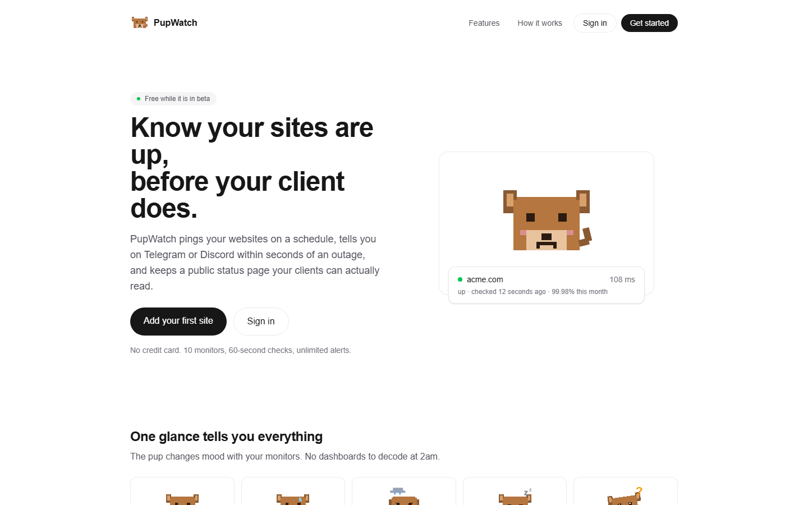
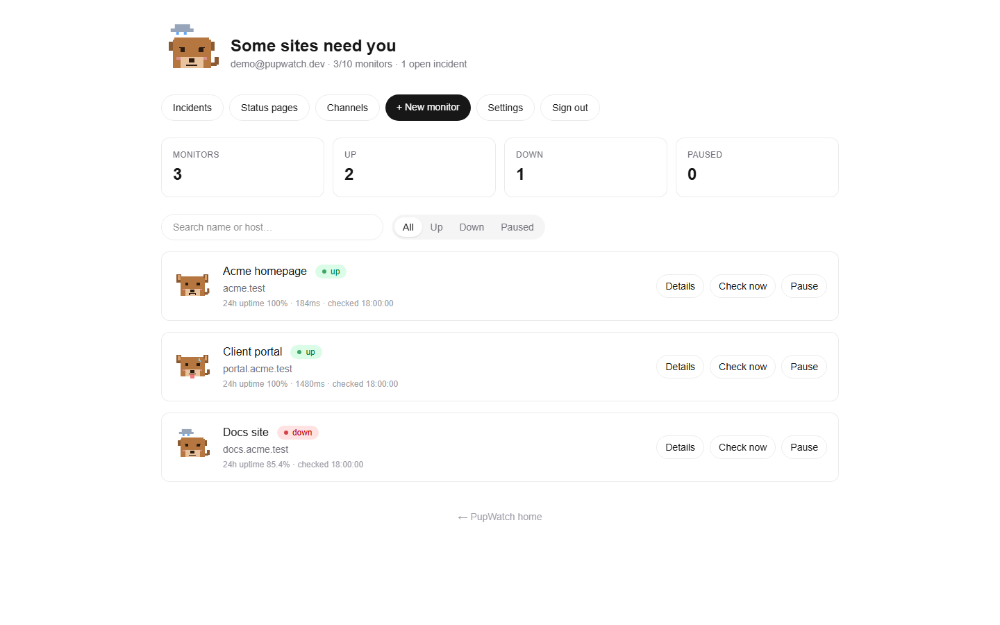
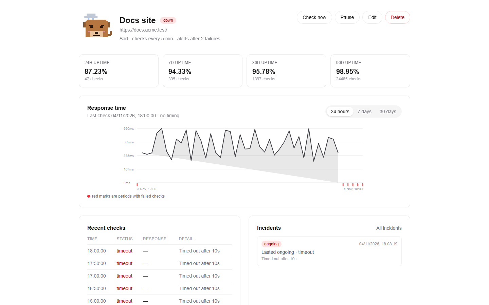
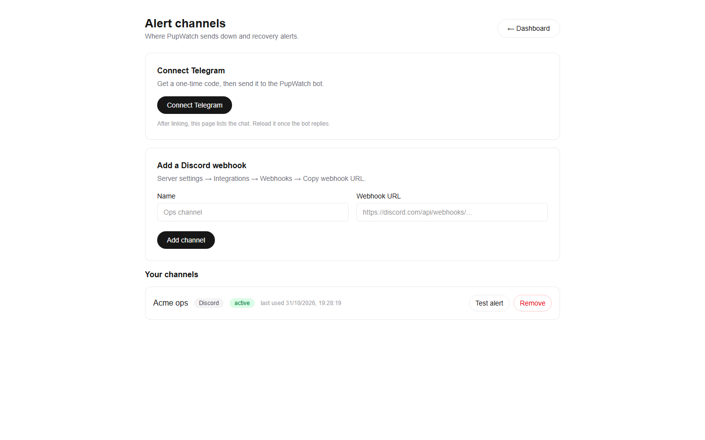
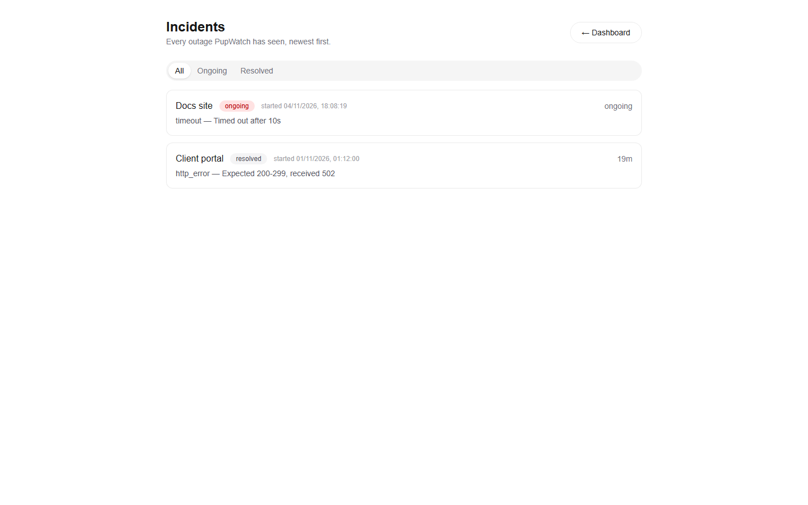
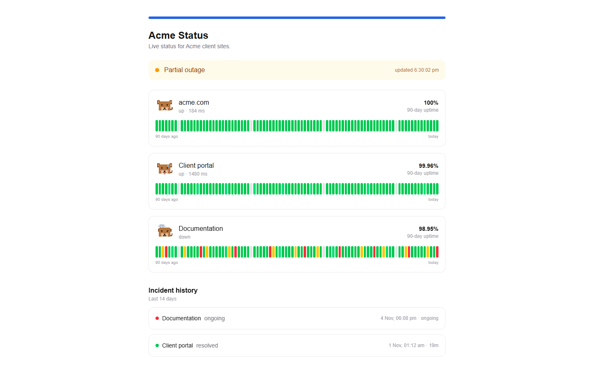
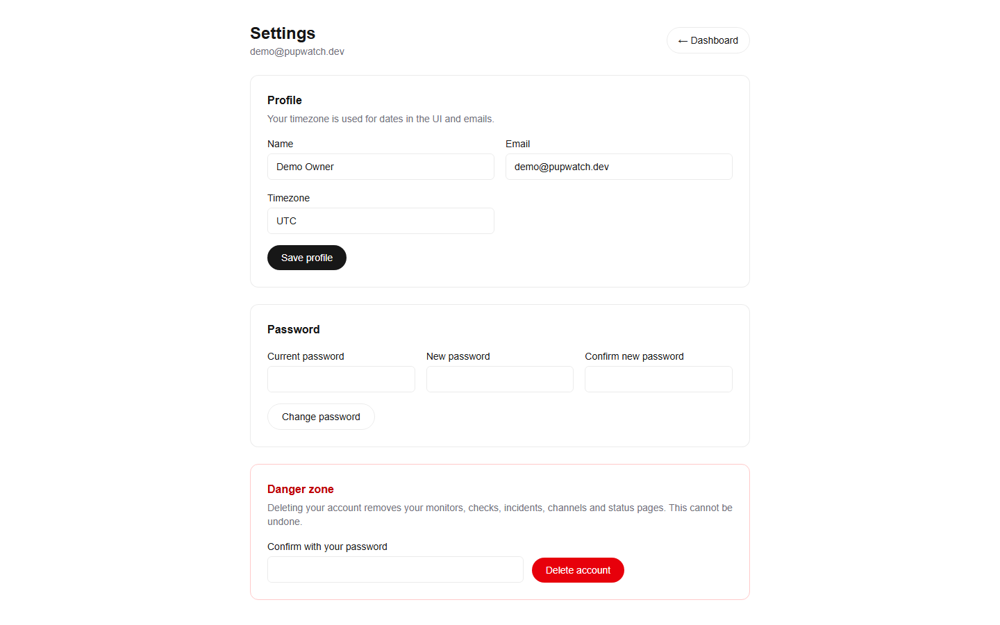
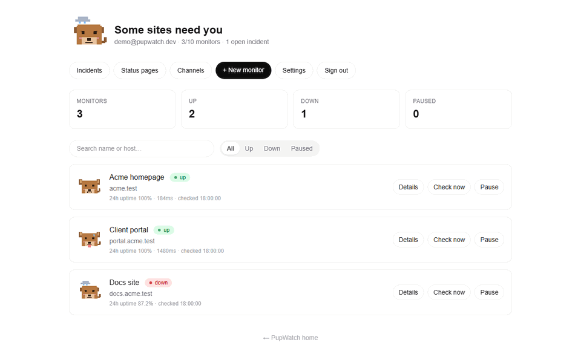

# PupWatch

> An uptime monitor with a pixel-art dog. Add your websites, and PupWatch checks them every
> minute. The dog is happy when your site is up, panting when it is slow, sad when it is down.

**Stack:** Next.js (TypeScript) · Tailwind CSS · Laravel (PHP 8.3) · MySQL 8 · Telegram Bot API ·
Discord Webhooks

📖 Full requirements: [PupWatch_PRD.md](PupWatch_PRD.md) · 🧠 Build decisions: [docs/decisions.md](docs/decisions.md)

## What it does

- **Monitors** — add a URL, pick a 60s/5m/15m interval, timeout (5–30s), expected status range,
  optional keyword check (`must_contain` / `must_not_contain`), up to five custom headers and an
  "alert after N failures" threshold. Pause and resume take effect immediately.
- **Checks** — an SSRF-guarded curl request with manual redirect handling, a 1 MB body cap and no
  stored response bodies. Every result is classified (timeout, DNS, connection, TLS, HTTP status,
  keyword) and stored in UTC.
- **Incidents** — one incident per outage, opened when the failure threshold is crossed and
  resolved by the first success. A flapping guard suppresses alert storms.
- **Alerts** — Discord webhooks (rich embeds) and Telegram (one-time code linking plus
  `/status`, `/pause`, `/resume`). Delivery is retried 3× with backoff; a channel that keeps
  failing is marked `needs_attention` and recovers automatically.
- **Dashboard** — mascot mood, summary counts, 24h uptime, search and status filters, 30-second
  polling.
- **Monitor detail** — response chart (24h / 7d / 30d), uptime chips (24h / 7d / 30d / 90d), last 50
  checks, incident history, channel linking, check-now (throttled) and pause/edit/delete.
- **Public status pages** — a server-rendered `/status/[slug]` page with an overall banner, 90-day
  uptime bars, the mascot, 14 days of incidents, optional response times/error details, accent
  colour, logo, `noindex` toggle and OG/Twitter metadata. Cached for 60 seconds.
- **Account** — profile, timezone, password change and full account deletion (cascades to every
  monitor, check, incident, channel and status page).

## Screenshots



| Dashboard | Monitor detail |
|---|---|
|  |  |

| Alert channels | Incidents |
|---|---|
|  |  |

| Public status page | Settings |
|---|---|
|  |  |

Twelve-second tour — dashboard, then a failing monitor:



Captured from a production build (`next build && next start`) against the demo seed.

## Architecture

```
┌──────────────────┐   HTTPS   ┌────────────────────────────┐  SQL  ┌──────────┐
│ Next.js (web)    │──────────▶│ Laravel API                │──────▶│ MySQL 8  │
│ SSR status pages │           │ Sanctum · Policies         │       └──────────┘
└──────────────────┘           │ Scheduler · Queue workers  │
                               └──────┬──────────┬──────────┘
                                      │          │
                          HTTP checks ▼          ▼ Alerts
                              user websites   Telegram API / Discord / Mail
```

- **`apps/web`** — Next.js App Router frontend: landing page, dashboard, monitor detail,
  status page builder and the public `/status/[slug]` pages. Auth happens through the API with
  an httpOnly cookie managed by Next.js route handlers, so the token is never reachable from
  browser JavaScript.
- **`apps/api`** — Laravel REST API (`/api/v1`), the check engine, the incident state machine
  and alert delivery. Business logic lives in `app/Services`; controllers stay thin.
- **MySQL 8** — `monitors`, `check_results` (high volume, 30-day retention), `incidents`,
  `daily_stats` (400-day rollups), channels and status pages.

### Scheduling design

1. `monitors.next_check_at` (indexed) holds when each monitor is due.
2. `DispatchDueChecks` runs every minute and, for each due monitor, performs an **atomic claim**:
   `UPDATE monitors SET next_check_at = … WHERE id = ? AND next_check_at <= now()` — the job is
   dispatched only when exactly one row was affected, so two workers can never check the same slot.
3. `RunMonitorCheck` runs on the `checks` queue, performs the SSRF-guarded HTTP request, stores a
   `check_results` row and feeds the incident state machine. Checks are never retried: a failed
   check is data.
4. `RecoverStuckClaims` (every 5 minutes) releases claims whose worker died.
5. Alerts go to a separate `alerts` queue so delivery is never starved by check traffic.

## Getting started

### Docker (recommended)

```bash
cp apps/api/.env.example apps/api/.env
cp apps/web/.env.example apps/web/.env.local
docker compose up --build
```

- Web → http://localhost:3000
- API → http://localhost:8000/api/v1/up
- MySQL → localhost:3306 (`pupwatch` / `secret`)

### Local development

API (SQLite, no database service needed):

```bash
cd apps/api
composer install
cp .env.example .env            # then set DB_CONNECTION=sqlite, DB_DATABASE=database/database.sqlite
php artisan key:generate
touch database/database.sqlite
php artisan migrate
php artisan serve               # http://localhost:8000
php artisan queue:work --queue=checks,alerts
php artisan schedule:run        # run every minute, e.g. via cron
```

Web:

```bash
cd apps/web
npm install
cp .env.example .env.local
npm run dev                     # http://localhost:3000
```

### Tests

```bash
cd apps/api && php artisan test    # PHPUnit, in-memory SQLite, HTTP faked
cd apps/web  && npm run lint && npx tsc --noEmit && npm run build
```

CI runs both on every push and pull request (`.github/workflows/ci.yml`).

## Repository layout

```
pupwatch/
├── apps/
│   ├── web/                      # Next.js (App Router, TypeScript, Tailwind)
│   │   └── src/app/…
│   └── api/                      # Laravel
│       ├── app/Services/         # CheckService, SsrfGuard, IncidentService, AlertService…
│       ├── app/Jobs/
│       ├── app/Http/Controllers/Api/
│       ├── app/Policies/
│       └── tests/
├── docker-compose.yml
├── .github/workflows/ci.yml
├── docs/decisions.md
└── PupWatch_PRD.md
```

## Operations

The scheduler and queue worker are the two long-running pieces:

```bash
php artisan schedule:work                              # every minute: dispatch, rollups, pruning
php artisan queue:work --queue=checks,alerts --tries=1  # checks and alert delivery
```

Scheduled entries (`routes/console.php`):

| Time | Command | Purpose |
|---|---|---|
| every minute | `DispatchDueChecks` | atomic claim + dispatch due checks |
| every 5 min | `RecoverStuckClaims` | release claims from crashed workers |
| every 10 min | `PruneExpiredTelegramTokens` | one-time link codes |
| 00:05 daily | `RollupDailyStats` | aggregate yesterday into `daily_stats` |
| 03:10 daily | `PruneOldData` | raw checks > 30 days, rollups > 400 days, in chunks |

Backfill a day manually (idempotent):

```bash
php artisan tinker --execute="(new AppJobsRollupDailyStats('2026-10-01'))(app(AppServicesRollupService::class));"
```

Health check: `GET /up` (Laravel's built-in endpoint). Failed jobs land in `failed_jobs` as usual.

## Demo data

```bash
cd apps/api && php artisan db:seed
```

Creates `demo@pupwatch.dev` / `pupwatch-demo` with three monitors (fast, slow, down), 90 days of
history and a public page at `/status/pupwatch-demo`. The seeder is refused in production unless
`DEMO_SEED=true`.

## Security notes

- **SSRF guard** — every outbound request is checked structurally (scheme, port, IP literal) and
  resolved through an injectable DNS resolver; private, reserved, loopback, link-local and
  IPv4-mapped IPv6 ranges are rejected. Each redirect hop is re-validated, and the resolved IP is
  pinned with `CURLOPT_RESOLVE` so DNS cannot change between check and connect.
- **No response bodies** are stored or returned; only status, timing and a short error.
- **Secrets at rest** — webhook URLs, Telegram chat ids and custom headers use Laravel's
  `encrypted` cast and are never serialised into API responses.
- **Sessions** — Sanctum tokens live in an httpOnly, SameSite=Lax cookie set by Next.js route
  handlers. The Laravel origin is only reachable server-side; no token touches browser JS.
- **Authorisation** — policies on monitors, channels and status pages; user ids come from the
  session, never from request input.
- **Rate limits** — auth 5/min per IP + email, authenticated API 60/min per user, public endpoints
  30/min per IP.
- **Telegram webhook** — secret path segment compared with `hash_equals`; unconfigured secrets
  reject every call.

## Deployment

The app is two deployables plus MySQL. Nothing here is deployed for you; pick a host and set the
variables from the two `.env.example` files.

**API** (PHP 8.3 + MySQL 8). Build once, then run three processes:

```bash
composer install --no-dev --optimize-autoloader
php artisan migrate --force
php artisan config:cache && php artisan route:cache

php artisan serve --host=0.0.0.0 --port=8000        # or php-fpm behind nginx
php artisan queue:work --queue=checks,alerts --tries=1 --timeout=60   # one or more workers
# cron: * * * * * cd /app && php artisan schedule:run >> /dev/null 2>&1
```

Required: `APP_KEY`, `APP_URL`, `FRONTEND_URL`, `DB_*`, `QUEUE_CONNECTION=database`,
`CACHE_STORE=database`, `SANCTUM_STATEFUL_DOMAINS`, and for Telegram `TELEGRAM_BOT_TOKEN`,
`TELEGRAM_BOT_USERNAME`, `TELEGRAM_WEBHOOK_SECRET`. Register the webhook with
`https://api.telegram.org/bot<token>/setWebhook?url=https://api.example.com/api/v1/telegram/webhook/<secret>`.

**Web** (Node 22):

```bash
npm ci && npm run build
API_BASE_URL=https://api.example.com NEXT_PUBLIC_APP_URL=https://pupwatch.example.com npm run start
```

`API_BASE_URL` is server-side only: the browser talks to Next.js route handlers, which forward to the
API and keep the Sanctum token in an httpOnly cookie.

**Checklist before going live:** HTTPS on both origins, `APP_DEBUG=false`, `APP_ENV=production`,
the scheduler and at least one worker running, a database backup, and `DEMO_SEED` left unset.

> The Milestone 6 "done when" asks for a public URL. This repository is not deployed: it needs a host
> with PHP + MySQL for the API and a Node runtime for the web app (or Docker Compose on a VPS).

## Milestones

| # | Milestone | Status |
|---|---|---|
| 0 | Setup: monorepo, Laravel + Next.js, Docker Compose, env examples, CI | ✅ |
| 1 | Auth (Sanctum cookie flow) + monitor CRUD + dashboard list | ✅ |
| 2 | SSRF guard + check engine, dispatcher with atomic claim | ✅ |
| 3 | Incidents + Telegram/Discord alert channels | ✅ |
| 4 | Dashboard, charts, uptime, mascot moods | ✅ |
| 5 | Daily rollups, retention, public status pages | ✅ |
| 6 | Polish: landing page, settings, demo seed, accessibility, docs, screenshots, demo GIF | 🚧 (built and documented; not deployed — needs a host) |